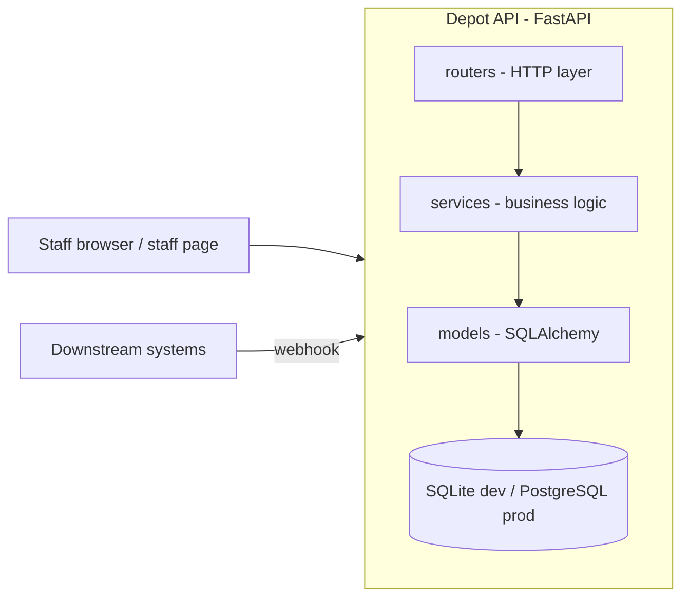

# Architecture

Depot is a single FastAPI service backed by a relational database.

## Layers

- `app/routers/` — HTTP layer only: parsing, status codes, calling services.
- `app/services/` — business logic; never imports FastAPI so it stays testable
  and reusable (CLI jobs, future workers).
- `app/models/` + `app/schemas/` — SQLAlchemy models mirrored by Pydantic
  schemas; every schema change ships with an Alembic migration.
- `app/flags.py` — env-based feature flags for shipping behind toggles.

## External dependencies

| Dependency | Purpose | Notes |
| --- | --- | --- |
| SQLite (dev) / PostgreSQL (prod) | Primary datastore | Configured via `DEPOT_DATABASE_URL` |
| Downstream systems | Consume order events via webhook | Story: "More stories (webhooks...)" in SPEC.md |

## Request flow

Every request gets a request ID (propagated from `X-Request-ID` or generated),
which is attached to all structured log lines for that request. Request metrics
are exposed at `/metrics` in Prometheus format.
